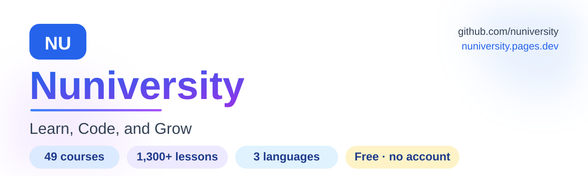

  <picture>
    <source media="(prefers-color-scheme: dark)" srcset="https://raw.githubusercontent.com/nuniversity/.github/main/assets/hero-dark.svg">
    
  </picture>

  # Nuniversity

  **Practice-first digital learning — free, in English, Portuguese and Spanish.**

  *Courses · mock exams · interactive tools · educational games · focus-friendly extras*

  [🌐 **Start learning**](https://nuniversity.pages.dev/en) · [🎯 Mock exams](https://nuniversity.pages.dev/en/quizzes/) · [🛠 Tools](https://nuniversity.pages.dev/en/tools/) · [🤝 Partnerships](https://nuniversity.pages.dev/en/partners/)

  
  
  
  

  🇧🇷 Português: aprenda tecnologia com cursos, simulados e jogos — gratuito · 🇪🇸 Español: cursos, simulacros y juegos — gratuito

---

## 🎁 What is Nuniversity?

A non-profit learning platform where everything is designed so you **learn by doing** — reading is never enough:

## 📚 What can you learn?

| | Area | What you'll actually do | Topics |
|:--|:--|:--|:--|
| ☁️ | **Cloud certifications** | Sit full mock exams with 1,658 curated questions and earn scored certificates | AWS AI Practitioner (AIF‑C01) · AWS Cloud Practitioner (CLF‑C02) · AWS Data Engineer (DEA‑C01) · SnowPro® Core (COF‑C03) |
| 🤖 | **AI & agents** | Build agent-style thinking step by step: tools, memory, guardrails, prompt craft | LangGraph · CrewAI · prompt engineering · agent memory & observability |
| 💻 | **Programming & software craft** | Code along lessons and turn theory into habit | Python · Rust · SQL · Spark · Clean Code & Architecture · SOLID · TDD · algorithms |
| 📊 | **Data engineering** | Model, move and transform data on real platform patterns | AWS data platforms · Databricks · dbt + Redshift · lakehouse · multi-cloud |
| 🗣️ | **Languages** | Practice vocabulary the smart way — the review schedule adapts to you | English · Spanish · French (for Portuguese speakers) · 2,700+ items |
| 🧭 | **Guided paths** | Follow a curated roadmap instead of wandering | Agentic AI development · software engineering foundations · Python developer |

[Browse the full course catalog →](https://nuniversity.pages.dev/en/courses/)

## 🕹 How learning feels here

| | Experience | Why it works | Go |
|:--|:--|:--|:--|
| 🧪 | **Interactive lessons** | Exercises, simulations and check-yourself moments inside every lesson | [Open a course](https://nuniversity.pages.dev/en/courses/) |
| 🎯 | **Mock exams + certificates** | Timed practice, instant scoring, downloadable certificates | [Try an exam](https://nuniversity.pages.dev/en/quizzes/) |
| 🧠 | **Smart review** | The spaced-repetition engine reminds you *just before* you'd forget | [See your progress](https://nuniversity.pages.dev/en/quizzes/certificates/) |
| 🎮 | **Educational games** | Typing races, logic, math, chemistry — practice disguised as fun | [Play](https://nuniversity.pages.dev/en/games/) |
| 🛠 | **Real productivity tools** | Eisenhower & SWOT matrices, LLM Prompt Builder, Regex Tester, Pomodoro — ready to use | [Open the toolbox](https://nuniversity.pages.dev/en/tools/) |
| 🗣️ | **Language players** | Vocabulary, flashcards and translation practice | [Learn a language](https://nuniversity.pages.dev/en/languages/) |

> [!TIP]
> **Pick your best first step:**
> 🎯 *Studying for a certification?* → a [mock exam](https://nuniversity.pages.dev/en/quizzes/) shows you where you stand in 10 minutes.
> 🧑‍💻 *Starting from zero?* → the [intro to programming roadmap](https://nuniversity.pages.dev/en/roadmaps/).
> 🗣️ *Practicing a language?* → the [vocabulary players](https://nuniversity.pages.dev/en/languages/).
> 🇧🇷🇪🇸 *Prefers Portuguese or Spanish?* → switch languages in the header, everywhere.

## 🤲 Our promises to every learner

> [!IMPORTANT]
> ### Free. Forever. For everyone.
> - 💸 **No ads. No paywalls. No premium tier.** Learning is the product.
> - 🔒 **No account needed.** Open the site and start; your progress stays on your own device.
> - 🌍 **Fully trilingual** — interface *and* content, not just menus.
> - ♿ **Accessible by design** — spoken descriptions for every visual, print-friendly lessons, calm motion.
> - ⚡ **Light as a page, not an app** — nothing to install; it just opens and works.

If the platform saved you study time, [a donation](https://nuniversity.pages.dev/en/donate/) keeps it free for the next learner — PIX accepted (R$ 5 · 10 · 25 · 50 or your own amount).

## 🧪 What's coming — learn by building

We are preparing **open lab projects**: small, self-contained projects you can download, remix and build together with the community — the same material our course tracks teach, made to be yours.

🤖 agentic AI lab · 🦀 Rust lab · 🗃️ SQL lab — *watch this org*:

  

## 📄 Use & share

Everything here is free for learning and classroom use. Sharing quotes with attribution is welcome; selling or rebranding the content is not (full [terms of use](https://nuniversity.pages.dev/en/terms/)). The upcoming labs will be released under permissive open-source licenses. For anything unusual, [just ask](mailto:nuniversity.npo@gmail.com) — we often say yes.

## 🤝 Connect with us

| | | |
|:--:|:--|--:|
| 📫 [Email us](mailto:nuniversity.npo@gmail.com) | 🤝 [Partner program](https://nuniversity.pages.dev/en/partners/) | 💗 [Donate](https://nuniversity.pages.dev/en/donate/) |
| 📞 [Contact form](https://nuniversity.pages.dev/en/contact/) | ▶️ [YouTube](https://www.youtube.com/@nuniversity) | 🔗 [LinkedIn](https://www.linkedin.com/company/nuniversity/) · 📸 [Instagram](https://www.instagram.com/nuniversityedu/) |

  Found a wrong answer or a broken link? <a href="mailto:nuniversity.npo@gmail.com">Report it</a> — it gets fixed within a day. 
  © 2026 Nuniversity — <em>Learn, Code, and Grow</em>

