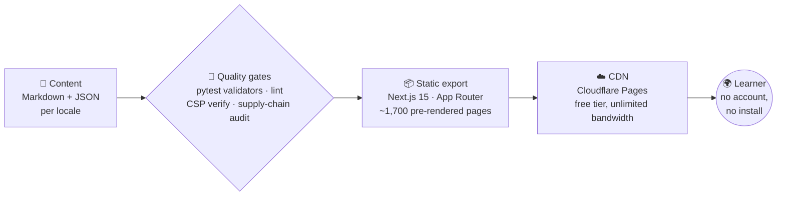

# 🎓 Nuniversity — Learn, Code, and Grow

**A non-profit educational platform: interactive courses, tools, games and exam practice — free for everyone, in English, Portuguese and Spanish.**

> *"To make transformational education universally accessible."*

> **🇧🇷** Aprenda tecnologia com cursos interativos, simulados e ferramentas — gratuito, em português.
> **🇪🇸** Aprende tecnología con cursos interactivos, simulacros y herramientas — gratuito, en español.

---

## 📣 The platform, in numbers

*As of November 2026 — refreshed with each content release.*

## 📦 What's inside

| | Feature | What you get | Jump in |
|---|---|---|---|
| 🎯 | **Certification prep** | Full courses + mock exams with 1,658 curated questions — AWS AI Practitioner (AIF‑C01), AWS Cloud Practitioner (CLF‑C02), AWS Data Engineer (DEA‑C01), SnowPro® Core (COF‑C03) | [Take a mock exam](https://nuniversity.pages.dev/en/quizzes/) |
| 🛠 | **Interactive tools** | Eisenhower & SWOT matrices, LLM Prompt Builder, Regex Tester (ReDoS‑isolated), Pomodoro, Flashcard Maker and more | [Open the toolbox](https://nuniversity.pages.dev/en/tools/) |
| 🎮 | **Learning games** | Typing, logic, math, physics, chemistry and conversation — practice without feeling like practice | [Play](https://nuniversity.pages.dev/en/games/) |
| 🗣 | **Languages** | English, Spanish and French courses for Portuguese speakers + 5 vocabulary decks (2,700+ items) | [Learn a language](https://nuniversity.pages.dev/en/languages/) |
| 🧭 | **Roadmaps** | Guided paths: Agentic AI development, Software Engineering fundamentals, Python developer | [Follow a roadmap](https://nuniversity.pages.dev/en/roadmaps/) |
| 🧠 | **Mastery engine** | FSRS spaced repetition + certificate scoring — your progress stays **in your browser**, no account required | [See certificates](https://nuniversity.pages.dev/en/quizzes/certificates/) |

Everything above ships per module in the ecosystem and works in `/en/`, `/pt/` and `/es/` — [choose your language](https://nuniversity.pages.dev/en/).

## ⚙️ How it's built

**Engineering choices we're proud of:**

- 🔐 **Content-Security-Policy on every page** — injected at build time and verified by a dedicated gate; `'unsafe-eval'` was deliberately removed from the policy.
- 🕵️ **No accounts, no analytics, no trackers** — mastery scores live in `localStorage`, on your machine.
- 🔗 **Pinned supply chain** — `npm audit signatures`, checksum-verified security scanners, Dependabot, and a hard pre-commit gate (Bandit, ESLint security rules, gitleaks).
- ♿ **Accessibility-first** — audio descriptions authored for every visual; motion-safe animations; print-friendly lessons.
- 💸 **Zero-infrastructure costs** — pure static output on a CDN; donations fund people, not servers.

## 🚀 Try it now (no signup)

| Language | Start | |
|---|---|---|
| 🇺🇸 English | [nuniversity.pages.dev/en](https://nuniversity.pages.dev/en) | |
| 🇧🇷 Português | [nuniversity.pages.dev/pt](https://nuniversity.pages.dev/pt) | |
| 🇪🇸 Español | [nuniversity.pages.dev/es](https://nuniversity.pages.dev/es) | |

One-click deep dives: an [833-question SnowPro mock exam](https://nuniversity.pages.dev/en/quizzes/snowpro-core-cof-c03/) · the [ReDoS-isolated Regex Tester](https://nuniversity.pages.dev/en/tools/regex-tester/) · an [English→Portuguese vocabulary player](https://nuniversity.pages.dev/en/languages/en-pt/).

## 💖 Why it's free — and why we can keep it free

> [!IMPORTANT]
> **No ads. No paywalls. No tracking. No accounts.** Learning stays the product.

Donations keep it that way. If the platform saved you study time:

- 💸 **PIX (Brazil)**, instant keys: **R$ 5 · R$ 10 · R$ 25 · R$ 50** or your own amount → [donate page](https://nuniversity.pages.dev/en/donate/) (Brazilian QR / copy-and-paste PIX key = `nuniversity.npo@gmail.com`; PayID in AU also supported).
- Every cent goes to content, translations and accessibility work — there is no server bill to pay thanks to the static architecture.

## 🧪 Coming soon — open-source labs

> [!NOTE]
> We are opening up reusable **lab projects** — small, self-contained “learn by building” repositories alongside the platform.

| Lab | What you'll build together with us | Planned license |
|---|---|---|
| 🤖 **Agentic AI lab** | A production-style LangGraph agent: tools, memory, evaluation, observability — the code behind the platform's agent course track | MIT |
| 🦀 **Rust lab** | Learn Rust through hands-on experiments instead of slides | MIT / Apache‑2.0 |
| 🗃️ **SQL lab** | A query-along data set + graduated challenges from first `SELECT` to window functions | MIT |

⭐ Watch/star this organization — labs will appear here first, and every lab will be under a permissive license so you can fork, remix and teach with them.

## 📄 License & reuse

- The **platform source** (site, content, tools) is released under a *source-available, non-commercial educational license*: learn with it, remix it privately, quote it in class with attribution — just don't sell it or rebrand it. [Full terms](https://nuniversity.pages.dev/en/terms/).
- The **upcoming lab projects** (section above) will be genuinely open source under MIT / Apache‑2.0.
- For anything outside those bounds (mirroring, commercial training, bundling), just **email us** — we often simply say yes.

## 🤝 Connect

- 📫 **Contact / partnerships**: `nuniversity.npo@gmail.com` — [or use the contact form](https://nuniversity.pages.dev/en/contact/) · [partners program](https://nuniversity.pages.dev/en/partners/)
- ▶️ [YouTube — tutorials and course materials](https://www.youtube.com/@nuniversity) · [LinkedIn](https://www.linkedin.com/company/nuniversity/) · [Instagram](https://www.instagram.com/nuniversityedu/)
- 🐛 Found a bug or a broken lesson link? Email us — it's a static site, so every fix ships within a day.

---

  🌍 Built with Next.js · hosted on Cloudflare's free tier · made possible by study-time donations. 
  © 2026 Nuniversity — <em>Learn, Code, and Grow</em>

